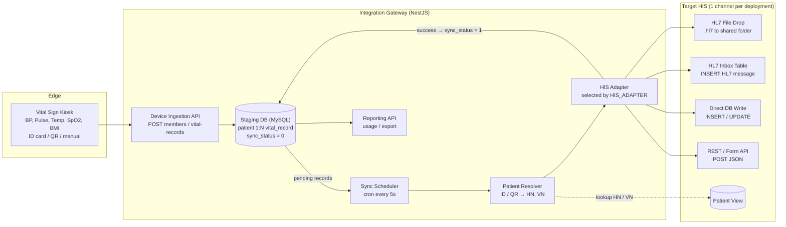
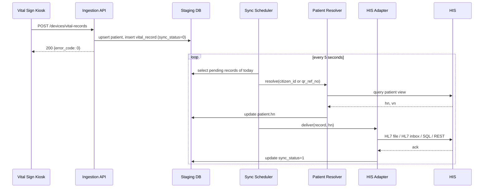
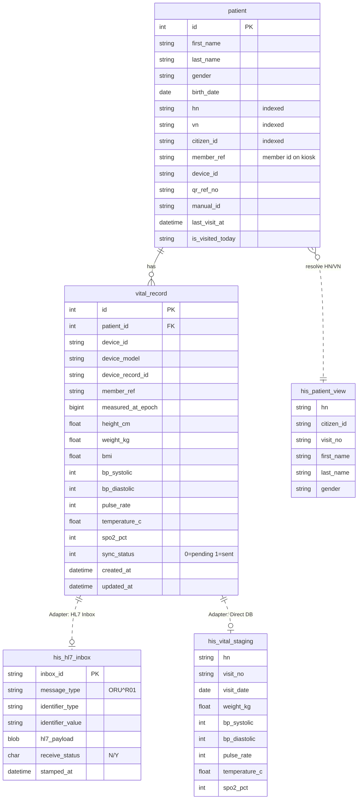

[ไทย](README.md) | [English](README.en.md)

# OPD Vital Sign Integration Gateway

> System Analysis & Architecture (non-NDA version)
> Company, hospital and HIS vendor names, server addresses and credentials have been removed.
> Table, field and endpoint names are replaced with generic names. All sample data is fake.

A middleware service that takes vital signs from self-service kiosks and pushes them into the hospital's HIS (Hospital Information System) every 5 seconds. One codebase supports several HIS types; the adapter is picked by a single config value.

**Tech Stack:** NestJS 10 (TypeScript) · TypeORM · MySQL (staging DB) · MSSQL / MySQL (HIS side) · @nestjs/schedule · Axios · Docker

### My Role (Systems Analyst)

- Gathered requirements from OPD triage nurses and the IT teams at each hospital
- Designed the store-and-forward architecture and the HIS adapter layer (strategy pattern) so it could support different HIS types
- Defined the integration specs with HIS developers: REST API, HL7 v2.3 / v2.6 mapping, database view lookup
- Designed the staging DB schema and the usage report
- Set the access control, PDPA (Thai personal data protection) and ISO/IEC 27001 guidelines for patient data
- Coordinated on-site testing (SIT / UAT) through to go-live

---

## 1. Problem & Solution

### Problem

- **Double entry:** At OPD triage, nurses measure BP, pulse, temperature, SpO2, weight and height, then type everything into the HIS by hand. Queues are slow and typos happen.
- **Every HIS takes data differently:** some take HL7 files, some take HL7 through an inbox table, some need direct database writes, some have a REST API.
- **Patient IDs don't match:** the kiosk reads a national ID card, a QR code on the visit slip, or a code typed in by hand. The HIS needs the HN/VN of today's visit.
- **Unstable network:** if the kiosk sends straight to the HIS and the HIS is down, the reading is lost.

### Solution

| Component | What it does |
| --- | --- |
| Device Ingestion API | Takes member and reading batches (JSON) from the kiosk and replies right away without waiting for the HIS |
| Local Staging DB | Stores every reading with a `sync_status` flag (0 = pending, 1 = sent). Works as a store-and-forward queue |
| Patient Resolver | Maps ID card / QR to HN and VN using a view or function provided by the HIS |
| Sync Scheduler | Cron job every 5 seconds. Picks up today's unsent readings and hands them to the adapter |
| HIS Adapter (strategy pattern) | Converts a reading into what the target HIS accepts: HL7 file, HL7 inbox table, direct SQL, or REST/form API |
| Reporting API | Usage stats for 7 / 30 days, paged list of readings, export by date range |
| Daily Reset Job | Clears the "visited today" flag for all patients at midnight |

---

## 2. Data Flow & Architecture

Data goes one way, kiosk to HIS, in two steps: it is written to the staging DB right away (synchronous), then forwarded to the HIS every 5 seconds (asynchronous). A short HIS outage does not lose data.

### Architecture Diagram



### Steps

1. **Capture:** The patient identifies at the kiosk with an ID card, the QR code on the visit slip, or a typed code, then takes the measurements.
2. **Ingest:** The kiosk calls `POST /devices/members` and `POST /devices/vital-records`. The API replies `error_code = 0` immediately.
3. **Upsert patient:** Find `patient` by (`member_ref` + `device_id`) or (`citizen_id` + `device_id`). If not found, create one with `hn = NULL`.
4. **Store:** Insert into `vital_record` with `sync_status = 0`.
5. **Poll:** Every 5 seconds the scheduler selects `patient` JOIN `vital_record` WHERE `sync_status = 0` AND `created_at` is today.
6. **Resolve:** Call `POST /patients/lookup` with `citizen_id` (or `qr_ref_no` if there is no ID card), get HN / VN, then update `patient.hn` and set `is_visited_today = 1`.
7. **Transform & deliver:** The adapter converts the reading to the target HIS format (see table below).
8. **Acknowledge:** On success set `sync_status = 1`. On failure leave it at 0 and retry next round, same day only.
9. **Daily reset:** At 00:00, clear `is_visited_today` for everyone.
10. **Report:** The dashboard reads the staging DB through the reporting API. It never touches the HIS.

### Supported HIS Adapters

| Adapter | How it sends | Format | Success when |
| --- | --- | --- | --- |
| HL7 File Drop | Checks there is a visit today, then writes a file to a shared folder (SMB mount) | HL7 v2.6 ORU^R01 | File written |
| HL7 Inbox Table | Inserts into `his_hl7_inbox` with status `N` for the HIS to pick up. Maps device serial → station name | HL7 v2.3 ORU^R01 | Insert OK |
| Direct DB Insert | Inserts one row into `his_vital_staging` | SQL | Insert OK |
| Direct DB Update | Updates today's row in `his_visit`. First and second BP readings go to separate columns | SQL | Update OK |
| REST JSON | POSTs JSON to the HIS API | JSON | `error_code = 0` or `affected_rows = 1` |
| REST Multipart (HTTPS) | POSTs form-data with a `data` field holding JSON | JSON in form | Response is `OK` |
| Primary-Care REST | POSTs JSON (ID number + readings) to a primary care system | JSON | `status = SUCCESS` |

### Sequence Diagram



---

## 3. Main Database Tables (Simplified ERD)

The service owns only two tables in the staging DB: `patient` 1 → N `vital_record`. Tables on the HIS side belong to the HIS; the service only reads or writes them depending on the adapter.



### Staging DB tables

| Table | Keys | Purpose |
| --- | --- | --- |
| `patient` | PK `id`, index on `hn`, `vn`, `citizen_id` | Patients who used a kiosk. One row per (`citizen_id` or `member_ref`) + `device_id`, so the same person can have several rows across kiosks. `hn` is filled in later by the resolver |
| `vital_record` | PK `id`, FK `patient_id` | One row per measurement. Values not measured are NULL. The send queue is `sync_status = 0` + `created_at` today |

### HIS-side tables (examples per adapter)

| Table / object | Access | Used by |
| --- | --- | --- |
| `his_patient_view` or table-valued function | SELECT by `citizen_id` or `qr_ref_no` | Any adapter that needs HN |
| `his_visit_check()` | SELECT to check whether a visit exists today | HL7 File Drop |
| `his_hl7_inbox` | INSERT raw HL7 message; ID comes from an HIS sequence function | HL7 Inbox Table |
| `his_vital_staging` | INSERT one row per reading | Direct DB Write |
| `his_visit` | UPDATE today's visit row: first BP to `bp_*_1`, next BP to `bp_*_2` (re-measure) | Direct DB Update |

---

## 4. API Endpoints and Sample Payloads (Dummy Data)

All APIs return HTTP 200; `error_code = 0` means success.

| Method | Endpoint | Caller | Purpose |
| --- | --- | --- | --- |
| POST | `/api/v1/devices/members` | Kiosk | Upload members registered on the kiosk (upsert patient) |
| POST | `/api/v1/devices/vital-records` | Kiosk | Upload readings in a batch, saved with `sync_status = 0` |
| POST | `/api/v1/patients/lookup` | Sync Scheduler | multipart/form-data; look up the patient in the HIS by `citizen_id` or `qr_ref_no` |
| GET | `/api/v1/reports/usage` | Dashboard | Daily counts for 7 days + totals for 7 / 30 days / all time |
| GET | `/api/v1/reports/vitals?page=1&limit=50` | Dashboard | Latest readings, paged |
| GET | `/api/v1/reports/vitals/export?start_date=&end_date=` | Dashboard | Readings in a date range, for Excel export |
| GET | `/api/v1/reports/vitals/earliest-date` | Dashboard | First date with data (date picker range) |

### 4.1 Upload readings from the kiosk

`POST /api/v1/devices/vital-records`

```json
{
  "device_id": "KIOSK-0001",
  "device_model": "VS-KIOSK-X1",
  "records": [
    {
      "device_record_id": "REC-20261112-0001",
      "citizen_id": "1100000000001",
      "qr_ref_no": null,
      "first_name": "Somchai",
      "last_name": "Test",
      "gender": "1",
      "age": 45,
      "height_cm": 170.5,
      "weight_kg": 68.2,
      "bmi": 23.46,
      "bp_systolic": 128,
      "bp_diastolic": 82,
      "pulse_rate": 76,
      "temperature_c": 36.7,
      "spo2_pct": 98,
      "measured_at_epoch": 1794470400000
    }
  ]
}
```

Response (returned right away; saving happens asynchronously):

```json
{ "error_code": 0, "error_msg": "Uploaded successfully" }
```

### 4.2 Patient lookup in the HIS

`POST /api/v1/patients/lookup` (form-data: `citizen_id=1100000000001`)

```json
[
  {
    "hn": "0001234",
    "citizen_id": "1100000000001",
    "title": "Mr.",
    "first_name": "Somchai",
    "last_name": "Test",
    "gender": "M",
    "visit_no": "691112000123",
    "queue_no": "0001",
    "birth_date": "1981-05-20"
  }
]
```

### 4.3 Outbound: REST/JSON adapter

```json
{
  "identify_type": "cid",
  "identify": "1100000000001",
  "first_name": "Somchai",
  "last_name": "Test",
  "gender": "M",
  "sys": 128,
  "dia": 82,
  "pulse": 76,
  "temp": 36.7,
  "spo2": 98,
  "weight": 68.2,
  "height": 170.5,
  "serial": "STATION-01",
  "model": "VS-KIOSK-X1",
  "measured_at": "2026-11-12T08:30:00+07:00"
}
```

`identify_type` is one of: `cid` (national ID card), `qr` (QR code or HN), `input` (typed by hand).

### 4.4 Outbound: HL7 v2.6 ORU^R01 (IHE PCD style, MDC codes)

Used by HL7 File Drop. File name: `{hn}_{record_id}_{yyyyMMddHHmmss}.hl7`

```
MSH|^~\&|VITAL-GW|KIOSK|EMR|HIS|20261112083000+0700||ORU^R01^ORU_R01|MSG20261112083000001|P|2.6|||AL|NE
PID|||0001234||Somchai^Test^^^^L|||M
PV1||O
OBR|1|||VITALS|||20261112083000+0700||||||||||||||||||F
OBX|1|NM|150021^MDC_PRESS_BLD_NONINV_SYS^MDC||128|266016^MDC_DIM_MMHG^MDC|||||F|||20261112083000+0700||||KIOSK-0001^VS-KIOSK-X1
OBX|2|NM|150022^MDC_PRESS_BLD_NONINV_DIA^MDC||82|266016^MDC_DIM_MMHG^MDC|||||F|||20261112083000+0700||||KIOSK-0001^VS-KIOSK-X1
OBX|3|NM|150344^MDC_TEMP^MDC||36.7|268192^MDC_DIM_DEGC^MDC|||||F|||20261112083000+0700||||KIOSK-0001^VS-KIOSK-X1
OBX|4|NM|150456^MDC_PULS_OXIM_SAT_O2^MDC||98|262688^MDC_DIM_PERCENT^MDC|||||F|||20261112083000+0700||||KIOSK-0001^VS-KIOSK-X1
OBX|5|NM|149546^MDC_PULS_RATE_NON_INV^MDC||76|264864^MDC_DIM_BEAT_PER_MIN^MDC|||||F|||20261112083000+0700||||KIOSK-0001^VS-KIOSK-X1
OBX|6|NM|68063^MDC_ATTR_PT_WEIGHT^MDC||68.2|263875^MDC_DIM_KILO_G^MDC|||||F|||20261112083000+0700||||KIOSK-0001^VS-KIOSK-X1
OBX|7|NM|68060^MDC_ATTR_PT_HEIGHT^MDC||170.5|263441^MDC_DIM_CENTI_M^MDC|||||F|||20261112083000+0700||||KIOSK-0001^VS-KIOSK-X1
OBX|8|NM|BMI^BMI^L||23.46|||||F|||20261112083000+0700||||KIOSK-0001^VS-KIOSK-X1
```

### 4.5 Outbound: HL7 v2.3 ORU^R01 (short form, inbox table)

Used by HL7 Inbox Table. The whole message is inserted into `his_hl7_inbox.hl7_payload` with `receive_status = 'N'`.

```
MSH|^~\&|STATION-01|VITAL-GW|HIS|HIS-APP|20261112083000||ORU^R01|0001|P|2.3
PID|1||0001234|1100000000001
PV1||O|||||||||||||||||691112000123
OBR|1|||||20261112083000||||||||20261112083000
OBX|1|NM|SYSTOLIC||128|mmHg||||||||20261112083000
OBX|2|NM|DIASTOLIC||82|mmHg||||||||20261112083000
OBX|3|NM|PULSE||76|bpm||||||||20261112083000
OBX|4|NM|TEMP||36.7|C||||||||20261112083000
OBX|5|NM|WEIGHT||68.2|kg||||||||20261112083000
OBX|6|NM|HEIGHT||170.5|cm||||||||20261112083000
OBX|7|NM|O2SAT||98|%||||||||20261112083000
```

---

## 5. Security & Lessons Learned

- **Patient data and security standards (PDPA & ISO 27001):** Access is split by department/site. Only the authorized gateway machine can reach the staging DB and the SMB shared folder. Data in transit goes over HTTPS. Data flow and asset register docs follow ISO/IEC 27001.
- **Patient identity on site:** Some patients have no ID card or no visit opened yet. The kiosk accepts the ID card, the QR code on the visit slip, or a typed HN / temporary code. If the nurse opens the visit in the HIS later, the same-day retry picks it up.
- **Repeat readings and stale data:** Repeat BP readings are supported (overwrite with the latest value, or separate columns, depending on the HIS). Sync only covers today's data so old readings never land on the next day's visit.
