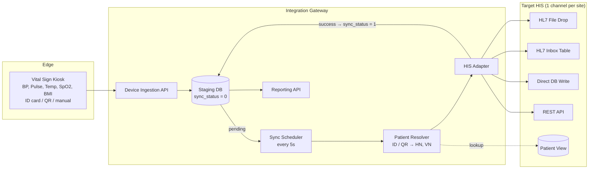
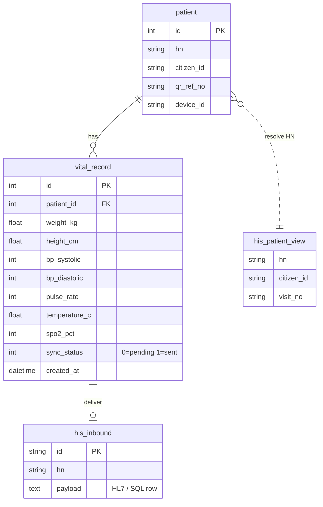

[ไทย](README.md) | [English](README.en.md)

# OPD Vital Sign Integration Gateway

> **Portfolio & NDA Notice:** This repository contains generalized system architecture, workflow diagrams, and sanitized API/data specifications created strictly for technical portfolio purposes. All proprietary source code, production endpoints, credentials, and client/institution identifiers have been omitted or replaced with generic mock data in strict compliance with Non-Disclosure Agreements (NDA).

Middleware that takes vital signs from self-service kiosks and pushes them into the hospital HIS (Hospital Information System) every 5 seconds. One codebase supports several HIS types; the adapter is picked by a single config value.

**Tech Stack:** NestJS (TypeScript) · TypeORM · MySQL (staging DB) · MSSQL / MySQL (HIS side) · Cron scheduler · Docker

### My Role (Systems Analyst)

- Gathered requirements from OPD triage nurses and hospital IT teams
- Designed the store-and-forward architecture and the HIS adapter layer (strategy pattern) to support different HIS types
- Defined integration specs with HIS developers: REST API, HL7 v2.3 / v2.6 mapping, database view lookup
- Designed the staging DB schema and the usage report
- Set access control, PDPA (Thai personal data protection) and ISO/IEC 27001 guidelines for patient data
- Coordinated on-site testing (SIT / UAT) through go-live

---

## 1. Problem & Solution

### Problem

- **Double entry:** Triage nurses measure BP, pulse, temperature, SpO2, weight and height, then type it all into the HIS. Slow queues, typos.
- **Every HIS takes data differently:** HL7 files, HL7 via an inbox table, direct DB writes, REST APIs.
- **Patient IDs don't match:** The kiosk reads an ID card, a QR code on the visit slip, or a typed code. The HIS needs the HN/VN of today's visit.
- **Unstable network:** If the kiosk sends straight to the HIS and the HIS is down, the reading is lost.

### Solution

| Component | What it does |
| --- | --- |
| Device Ingestion API | Takes reading batches (JSON) from the kiosk and replies right away |
| Staging DB | Stores every reading with a `sync_status` flag; acts as the store-and-forward queue |
| Patient Resolver | Maps ID card / QR to HN and VN using a view provided by the HIS |
| Sync Scheduler | Every 5 seconds, picks up today's unsent readings |
| HIS Adapter (strategy pattern) | Converts readings to HL7 file, HL7 inbox, direct SQL or REST, depending on the HIS |
| Reporting API | Usage stats and reading export |

---

## 2. Data Flow & Architecture

Two steps: write to the staging DB right away (synchronous), then forward to the HIS every 5 seconds (asynchronous). A short HIS outage does not lose data.



### Steps

1. **Capture:** The patient identifies at the kiosk (ID card / QR / typed code) and takes the measurements.
2. **Ingest:** The kiosk posts the readings. The API saves `patient` + `vital_record` with `sync_status = 0` and replies immediately.
3. **Poll:** Every 5 seconds the scheduler picks up today's readings with `sync_status = 0`.
4. **Resolve:** Look up HN / VN in the HIS patient view.
5. **Deliver:** The adapter converts the reading and sends it to the HIS.
6. **Acknowledge:** Success → `sync_status = 1`. Failure → retry next round, same day only.
7. **Daily reset:** Clear the day's visit flags at midnight.

### Supported HIS Adapters

| Adapter | How it sends | Format |
| --- | --- | --- |
| HL7 File Drop | Writes a file to a shared folder | HL7 v2.6 ORU^R01 |
| HL7 Inbox Table | Inserts the message into an inbox table for the HIS to pick up | HL7 v2.3 ORU^R01 |
| Direct DB Write | INSERT / UPDATE on the HIS vital sign table | SQL |
| REST API | POST JSON or form-data | JSON |

---

## 3. Key Entities (Simplified ERD)

The service owns two entities: `patient` and `vital_record`. On the HIS side it only uses a patient view for HN lookup and the inbound channel for the chosen adapter.



| Entity | Purpose |
| --- | --- |
| `patient` | Kiosk users. `hn` is filled in later by the resolver |
| `vital_record` | One row per measurement. `sync_status` is the send-queue state |
| `his_patient_view` | HIS-side view for HN / VN lookup (read only) |
| `his_inbound` | HIS-side target for the adapter: inbox table, vital sign table, or API |

---

## 4. Core API Endpoints & Sample Payloads (Dummy Data)

| Method | Endpoint | Purpose |
| --- | --- | --- |
| POST | `/api/v1/devices/vital-records` | Kiosk uploads a batch of readings |
| POST | `/api/v1/devices/members` | Kiosk uploads registered members |
| POST | `/api/v1/patients/lookup` | Look up a patient in the HIS by ID card or QR |
| GET | `/api/v1/reports/usage` | Usage stats for 7 / 30 days |
| GET | `/api/v1/reports/vitals` | List of readings (paged / by date range) |

### 4.1 Kiosk upload

`POST /api/v1/devices/vital-records`

```json
{
  "device_id": "KIOSK-0001",
  "records": [
    {
      "citizen_id": "1100000000001",
      "weight_kg": 68.2,
      "height_cm": 170.5,
      "bp_systolic": 128,
      "bp_diastolic": 82,
      "pulse_rate": 76,
      "temperature_c": 36.7,
      "spo2_pct": 98
    }
  ]
}
```

```json
{ "error_code": 0, "error_msg": "Uploaded successfully" }
```

### 4.2 Outbound to HIS: REST

```json
{
  "identify_type": "cid",
  "identify": "1100000000001",
  "sys": 128,
  "dia": 82,
  "pulse": 76,
  "temp": 36.7,
  "spo2": 98,
  "weight": 68.2,
  "height": 170.5,
  "measured_at": "2026-11-12T08:30:00+07:00"
}
```

`identify_type`: `cid` (national ID card), `qr` (QR / HN), `input` (typed by hand)

### 4.3 Outbound to HIS: HL7 v2.6 ORU^R01 (MDC codes)

```
MSH|^~\&|VITAL-GW|KIOSK|EMR|HIS|20261112083000+0700||ORU^R01^ORU_R01|MSG0001|P|2.6
PID|||0001234||Somchai^Test|||M
PV1||O
OBR|1|||VITALS|||20261112083000+0700
OBX|1|NM|150021^MDC_PRESS_BLD_NONINV_SYS^MDC||128|266016^MDC_DIM_MMHG^MDC|||||F
OBX|2|NM|150022^MDC_PRESS_BLD_NONINV_DIA^MDC||82|266016^MDC_DIM_MMHG^MDC|||||F
OBX|3|NM|150344^MDC_TEMP^MDC||36.7|268192^MDC_DIM_DEGC^MDC|||||F
OBX|4|NM|150456^MDC_PULS_OXIM_SAT_O2^MDC||98|262688^MDC_DIM_PERCENT^MDC|||||F
OBX|5|NM|149546^MDC_PULS_RATE_NON_INV^MDC||76|264864^MDC_DIM_BEAT_PER_MIN^MDC|||||F
OBX|6|NM|68063^MDC_ATTR_PT_WEIGHT^MDC||68.2|263875^MDC_DIM_KILO_G^MDC|||||F
OBX|7|NM|68060^MDC_ATTR_PT_HEIGHT^MDC||170.5|263441^MDC_DIM_CENTI_M^MDC|||||F
```

---

## 5. Security & Lessons Learned

- **Patient data and security standards (PDPA & ISO 27001):** Access is split by department/site. Only the authorized gateway machine can reach the staging DB and shared folder. Data in transit goes over HTTPS. Data flow and asset register docs follow ISO/IEC 27001.
- **Patient identity on site:** Some patients have no ID card or no visit opened yet. The kiosk accepts ID card, QR on the visit slip, or a typed HN / temporary code. If the nurse opens the visit later, the same-day retry picks it up.
- **Repeat readings and stale data:** Repeat BP readings are supported (overwrite with the latest value, or separate columns, depending on the HIS). Sync only covers today's data, so old readings never land on the next day's visit.
