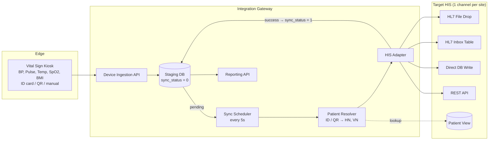
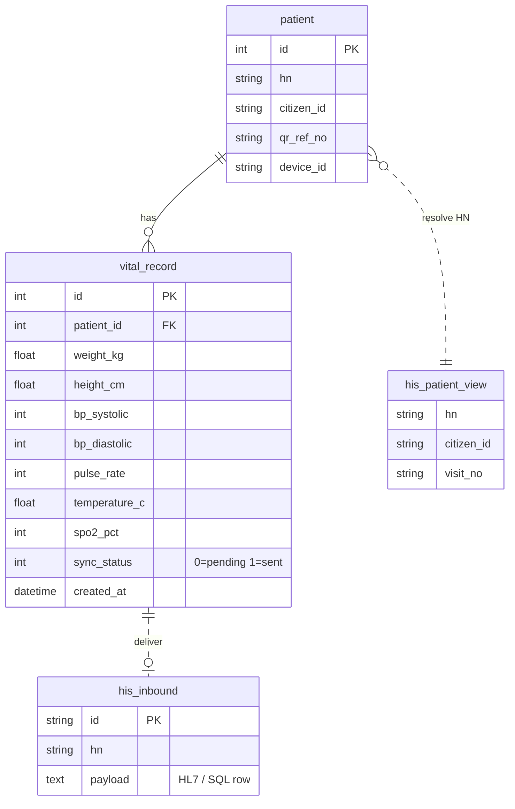

[ไทย](README.md) | [English](README.en.md)

# OPD Vital Sign Integration Gateway

> **หมายเหตุเรื่องความลับทางการค้า (NDA Notice):** เอกสารใน Repository นี้จัดทำขึ้นเพื่อแสดงแนวคิดการออกแบบสถาปัตยกรรมระบบและ Workflow สำหรับประกอบการสมัครงานเท่านั้น ซอร์สโค้ดจริง Endpoint ของระบบ Production ข้อมูลรับรอง (Credentials) รวมถึงชื่อองค์กรและลูกค้าทั้งหมดถูกตัดออกหรือแทนที่ด้วยข้อมูลสมมติเพื่อปฏิบัติตามข้อตกลงรักษาความลับ (NDA) อย่างเคร่งครัด

Middleware รับค่าสัญญาณชีพจากตู้วัดอัตโนมัติ (Vital Sign Kiosk) แล้วส่งเข้า HIS (Hospital Information System) ของสถานพยาบาลอัตโนมัติทุก 5 วินาที โค้ดชุดเดียวรองรับ HIS ได้หลายแบบ โดยเลือก Adapter จากค่า Config ตัวเดียว

**Tech Stack:** NestJS (TypeScript) · TypeORM · MySQL (Staging DB) · MSSQL / MySQL (ฝั่ง HIS) · Cron Scheduler · Docker

### หน้าที่ที่รับผิดชอบ (Role: Systems Analyst)

- เก็บ Requirement จากพยาบาลจุดคัดกรอง OPD และทีม IT ของโรงพยาบาลปลายทาง
- ออกแบบสถาปัตยกรรมระบบแบบ Store-and-Forward และโครงสร้าง HIS Adapter (Strategy Pattern) ให้รองรับ HIS หลากหลายรูปแบบ
- กำหนด Spec การเชื่อมต่อข้อมูล (REST API, HL7 v2.3 / v2.6 Mapping, Database View Lookup) ร่วมกับผู้พัฒนาระบบ HIS
- ออกแบบโครงสร้างฐานข้อมูล Staging DB และระบบรายงานสรุปสถิติการใช้งาน
- วางแนวทางการคุมสิทธิ์ การป้องกันข้อมูลส่วนบุคคล (PDPA) และมาตรฐานความปลอดภัย ISO/IEC 27001 สำหรับข้อมูลผู้ป่วย
- ประสานงานทดสอบการส่งข้อมูลจริงหน้างาน (SIT / UAT) จนระบบขึ้นใช้งานจริง (Go-Live)

---

## 1. ปัญหาและโซลูชัน (Problem & Solution)

### ปัญหา

- **คีย์ข้อมูลซ้ำ:** จุดคัดกรอง OPD วัด BP, ชีพจร, อุณหภูมิ, SpO2, น้ำหนัก, ส่วนสูง แล้วต้องพิมพ์เข้า HIS เอง คิวช้าและคีย์ผิดได้
- **HIS แต่ละแห่งรับข้อมูลต่างกัน:** มีทั้งไฟล์ HL7, HL7 ผ่านตาราง Inbox, เขียนลงฐานข้อมูลตรง และ REST API
- **ตัวระบุผู้ป่วยไม่ตรงกัน:** ตู้อ่านได้ทั้งบัตรประชาชน, QR บนใบนำทาง หรือรหัสที่กรอกเอง แต่ HIS ต้องใช้ HN/VN ของ Visit วันนั้น
- **เครือข่ายไม่เสถียร:** ถ้าส่งตรงจากตู้ไป HIS แล้ว HIS ล่ม ข้อมูลหาย

### โซลูชัน

| องค์ประกอบ | หน้าที่ |
| --- | --- |
| Device Ingestion API | รับผลวัดเป็น Batch JSON จากตู้ ตอบกลับทันทีโดยไม่รอ HIS |
| Staging DB | เก็บผลวัดทุกครั้งพร้อม `sync_status` ใช้เป็นคิว Store-and-Forward |
| Patient Resolver | แปลงบัตร / QR เป็น HN, VN จาก View ที่ HIS เตรียมไว้ |
| Sync Scheduler | ทุก 5 วินาที ดึงผลวัดของวันนี้ที่ยังไม่ส่ง |
| HIS Adapter (Strategy Pattern) | แปลงข้อมูลเป็น HL7 File, HL7 Inbox, Direct SQL หรือ REST ตาม HIS ปลายทาง |
| Reporting API | สถิติการใช้งานและ Export ผลวัด |

---

## 2. การไหลของข้อมูล (Data Flow & Architecture)

แยกเป็น 2 จังหวะ: รับเข้า Staging DB ทันที (Synchronous) แล้วส่งต่อเข้า HIS ทุก 5 วินาที (Asynchronous) HIS ล่มชั่วคราวข้อมูลก็ไม่หาย



### ลำดับขั้นตอน

1. **Capture:** ผู้ป่วยยืนยันตัวตนที่ตู้ (บัตร / QR / กรอกเอง) แล้ววัดค่า
2. **Ingest:** ตู้ส่งผลวัดเข้า API ระบบบันทึก `patient` + `vital_record` ด้วย `sync_status = 0` แล้วตอบกลับทันที
3. **Poll:** Scheduler ทุก 5 วินาทีดึงผลวัดของวันนี้ที่ `sync_status = 0`
4. **Resolve:** ค้น HN / VN จาก Patient View ของ HIS
5. **Deliver:** Adapter แปลงรูปแบบและส่งเข้า HIS
6. **Acknowledge:** สำเร็จ → `sync_status = 1` ล้มเหลว → ลองใหม่รอบถัดไป เฉพาะภายในวันเดียวกัน
7. **Daily Reset:** เที่ยงคืนล้างสถานะ Visit ของวัน

### HIS Adapter ที่รองรับ

| Adapter | วิธีส่ง | Format |
| --- | --- | --- |
| HL7 File Drop | เขียนไฟล์ลง Shared Folder | HL7 v2.6 ORU^R01 |
| HL7 Inbox Table | INSERT ข้อความลงตาราง Inbox ให้ HIS มาหยิบ | HL7 v2.3 ORU^R01 |
| Direct DB Write | INSERT / UPDATE ตาราง Vital Sign ของ HIS | SQL |
| REST API | POST JSON หรือ form-data | JSON |

---

## 3. Key Entities (Simplified ERD)

ระบบเป็นเจ้าของ 2 Entity หลัก คือ `patient` และ `vital_record` ฝั่ง HIS ใช้แค่ Patient View สำหรับค้น HN และช่องทางรับข้อมูลตาม Adapter



| Entity | หน้าที่ |
| --- | --- |
| `patient` | ผู้ป่วยที่ใช้ตู้ `hn` ถูกเติมภายหลังโดย Resolver |
| `vital_record` | ผลวัด 1 แถวต่อ 1 ครั้ง `sync_status` คือสถานะคิวส่ง |
| `his_patient_view` | View ฝั่ง HIS สำหรับค้น HN / VN (อ่านอย่างเดียว) |
| `his_inbound` | ปลายทางฝั่ง HIS ตาม Adapter: ตาราง Inbox, ตาราง Vital Sign หรือ API |

---

## 4. Core API Endpoints & Sample Payloads (Dummy Data)

| Method | Endpoint | หน้าที่ |
| --- | --- | --- |
| POST | `/api/v1/devices/vital-records` | ตู้ส่งผลวัดเป็น Batch |
| POST | `/api/v1/devices/members` | ตู้ส่งรายชื่อสมาชิกที่ลงทะเบียนไว้ |
| POST | `/api/v1/patients/lookup` | ค้นผู้ป่วยใน HIS ด้วยเลขบัตรหรือ QR |
| GET | `/api/v1/reports/usage` | สถิติการใช้งาน 7 / 30 วัน |
| GET | `/api/v1/reports/vitals` | รายการผลวัด (แบ่งหน้า / ตามช่วงวันที่) |

### 4.1 ตู้ส่งผลวัด

`POST /api/v1/devices/vital-records`

```json
{
  "device_id": "KIOSK-0001",
  "records": [
    {
      "citizen_id": "1100000000001",
      "weight_kg": 68.2,
      "height_cm": 170.5,
      "bp_systolic": 128,
      "bp_diastolic": 82,
      "pulse_rate": 76,
      "temperature_c": 36.7,
      "spo2_pct": 98
    }
  ]
}
```

```json
{ "error_code": 0, "error_msg": "Uploaded successfully" }
```

### 4.2 ส่งเข้า HIS แบบ REST

```json
{
  "identify_type": "cid",
  "identify": "1100000000001",
  "sys": 128,
  "dia": 82,
  "pulse": 76,
  "temp": 36.7,
  "spo2": 98,
  "weight": 68.2,
  "height": 170.5,
  "measured_at": "2026-11-12T08:30:00+07:00"
}
```

`identify_type`: `cid` (บัตรประชาชน), `qr` (QR / HN), `input` (กรอกเอง)

### 4.3 ส่งเข้า HIS แบบ HL7 v2.6 ORU^R01 (MDC Codes)

```
MSH|^~\&|VITAL-GW|KIOSK|EMR|HIS|20261112083000+0700||ORU^R01^ORU_R01|MSG0001|P|2.6
PID|||0001234||Somchai^Test|||M
PV1||O
OBR|1|||VITALS|||20261112083000+0700
OBX|1|NM|150021^MDC_PRESS_BLD_NONINV_SYS^MDC||128|266016^MDC_DIM_MMHG^MDC|||||F
OBX|2|NM|150022^MDC_PRESS_BLD_NONINV_DIA^MDC||82|266016^MDC_DIM_MMHG^MDC|||||F
OBX|3|NM|150344^MDC_TEMP^MDC||36.7|268192^MDC_DIM_DEGC^MDC|||||F
OBX|4|NM|150456^MDC_PULS_OXIM_SAT_O2^MDC||98|262688^MDC_DIM_PERCENT^MDC|||||F
OBX|5|NM|149546^MDC_PULS_RATE_NON_INV^MDC||76|264864^MDC_DIM_BEAT_PER_MIN^MDC|||||F
OBX|6|NM|68063^MDC_ATTR_PT_WEIGHT^MDC||68.2|263875^MDC_DIM_KILO_G^MDC|||||F
OBX|7|NM|68060^MDC_ATTR_PT_HEIGHT^MDC||170.5|263441^MDC_DIM_CENTI_M^MDC|||||F
```

---

## 5. ความปลอดภัยและบทเรียนจากหน้างาน (Security & Lessons Learned)

- **ข้อมูลผู้ป่วยและมาตรฐานความปลอดภัย (PDPA & ISO 27001):** แยกสิทธิ์การเข้าถึงข้อมูลตามหน่วยงาน/สาขา Staging DB และ Shared Folder เข้าได้เฉพาะเครื่อง Gateway ที่อนุญาต ส่งข้อมูลผ่าน HTTPS และทำเอกสาร Data Flow / Asset Register ตามแนวทาง ISO/IEC 27001
- **ระบุตัวผู้ป่วยหน้างานจริง:** บางรายไม่มีบัตรหรือยังไม่ได้เปิด Visit จึงรองรับทั้งบัตรประชาชน, QR บนใบนำทาง และกรอก HN/รหัสชั่วคราว ถ้าพยาบาลเปิด Visit ทีหลัง ระบบ Retry ภายในวันเดียวกันจะส่งให้เอง
- **วัดซ้ำและข้อมูลค้างข้ามวัน:** รองรับการวัดความดันซ้ำ (เขียนทับค่าล่าสุดหรือแยกคอลัมน์ตาม HIS) และ Sync เฉพาะข้อมูลวันปัจจุบัน ข้อมูลเก่าจึงไม่ไปทับ Visit ของวันถัดไป
