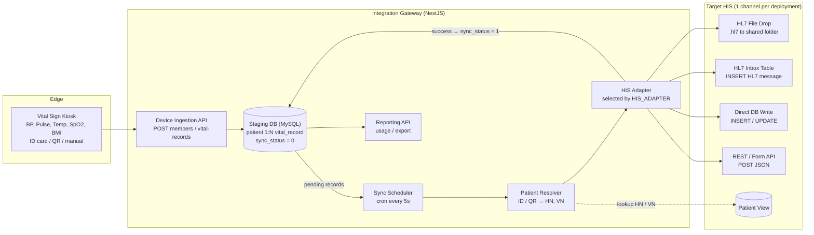
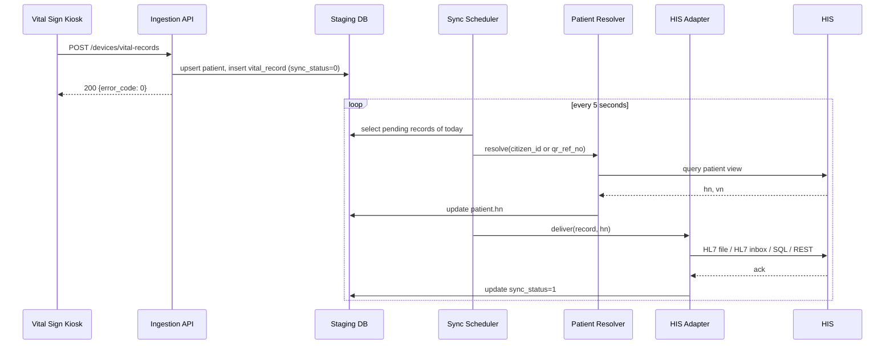
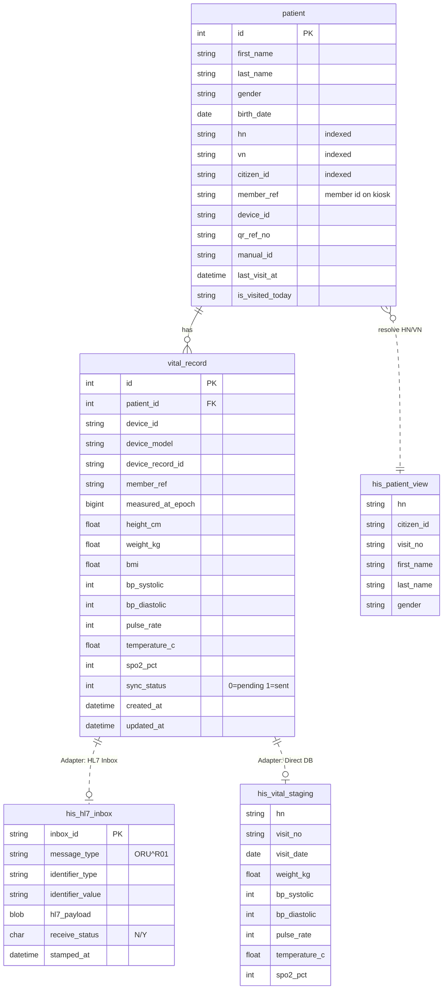

[ไทย](README.md) | [English](README.en.md)

# OPD Vital Sign Integration Gateway

> System Analysis & Architecture (ฉบับ Non-NDA)
> ชื่อองค์กร ชื่อสถานพยาบาล ชื่อผลิตภัณฑ์ HIS ของผู้ขาย ที่อยู่เซิร์ฟเวอร์ และ Credential ทั้งหมดถูกตัดออก
> ชื่อตาราง ตัวแปร และ Endpoint ถูกแทนด้วยชื่อมาตรฐานกลาง ข้อมูลตัวอย่างทั้งหมดเป็นข้อมูลสมมติ

Middleware ที่รับค่าสัญญาณชีพจากตู้วัดอัตโนมัติ (Vital Sign Kiosk) แล้วส่งเข้า HIS (Hospital Information System) ของสถานพยาบาลโดยอัตโนมัติทุก 5 วินาที โค้ดชุดเดียวรองรับ HIS ได้หลายแบบ โดยเลือก Adapter ผ่านค่า Config ตัวเดียว

**Tech Stack:** NestJS 10 (TypeScript) · TypeORM · MySQL (Staging DB) · MSSQL / MySQL (ฝั่ง HIS) · @nestjs/schedule · Axios · Docker

### หน้าที่ที่รับผิดชอบ (Role: Systems Analyst)

- เก็บ Requirement จากพยาบาลจุดคัดกรอง OPD และทีม IT ของโรงพยาบาลปลายทาง
- ออกแบบสถาปัตยกรรมระบบแบบ Store-and-Forward และโครงสร้าง HIS Adapter (Strategy Pattern) ให้รองรับ HIS หลากหลายรูปแบบ
- กำหนด Spec การเชื่อมต่อข้อมูล (REST API, HL7 v2.3 / v2.6 Mapping, Database View Lookup) ร่วมกับผู้พัฒนาระบบ HIS
- ออกแบบโครงสร้างฐานข้อมูล Staging DB และระบบรายงานสรุปสถิติการใช้งาน
- วางแนวทางการคุมสิทธิ์ การป้องกันข้อมูลส่วนบุคคล (PDPA) และมาตรฐานความปลอดภัย ISO/IEC 27001 สำหรับข้อมูลผู้ป่วย
- ประสานงานทดสอบการส่งข้อมูลจริงหน้างาน (SIT / UAT) จนระบบขึ้นใช้งานจริง (Go-Live)

---

## 1. ภาพรวมปัญหาและโซลูชัน (Problem & Solution)

### ปัญหา

- **คีย์ข้อมูลซ้ำ:** จุดคัดกรอง OPD ต้องวัด BP, ชีพจร, อุณหภูมิ, SpO2, น้ำหนัก, ส่วนสูง แล้วพิมพ์เข้า HIS เอง ทำให้คิวช้าและเสี่ยงคีย์ผิด
- **HIS แต่ละแห่งรับข้อมูลไม่เหมือนกัน:** บางแห่งรับไฟล์ HL7, บางแห่งรับ HL7 ผ่านตาราง Inbox, บางแห่งต้องเขียนลงฐานข้อมูลโดยตรง, บางแห่งมี REST API
- **ตัวระบุผู้ป่วยไม่ตรงกัน:** ตู้อ่านได้ทั้งเลขบัตรประชาชน, QR บนใบนำทาง หรือรหัสที่กรอกเอง แต่ HIS ต้องการ HN/VN ของ Visit วันนั้น
- **เครือข่ายไม่เสถียร:** ถ้าส่งตรงจากตู้ไป HIS แล้ว HIS ล่ม ข้อมูลจะหาย

### โซลูชัน

| องค์ประกอบ | หน้าที่ |
| --- | --- |
| Device Ingestion API | รับข้อมูลสมาชิกและผลวัดเป็น Batch JSON จากตู้ ตอบกลับทันทีโดยไม่รอ HIS |
| Local Staging DB | เก็บผลวัดทุกครั้ง พร้อม `sync_status` (0 = รอส่ง, 1 = ส่งสำเร็จ) ใช้เป็น Store-and-Forward Queue |
| Patient Resolver | แปลงเลขบัตร / QR เป็น HN, VN โดยอ่าน View หรือ Function ที่ฝั่ง HIS เตรียมไว้ |
| Sync Scheduler | Cron ทุก 5 วินาที ดึงเฉพาะผลวัดของวันนี้ที่ยังไม่ส่ง แล้วส่งต่อให้ Adapter |
| HIS Adapter (Strategy Pattern) | แปลงข้อมูลเป็นรูปแบบที่ HIS ปลายทางรับ: HL7 File, HL7 Inbox Table, Direct SQL หรือ REST/Form API |
| Reporting API | สถิติการใช้งาน 7 / 30 วัน, รายการผลวัดแบบแบ่งหน้า และ Export ตามช่วงวันที่ |
| Daily Reset Job | เที่ยงคืนล้างสถานะ "มา Visit วันนี้" ของผู้ป่วยทั้งหมด |

---

## 2. การไหลของข้อมูล (Data Flow & Architecture)

ข้อมูลไหลทางเดียวจากตู้ไป HIS แต่แยกเป็น 2 จังหวะ: รับเข้า Staging DB ทันที (Synchronous) และส่งต่อเข้า HIS ทุก 5 วินาที (Asynchronous) จึงทนต่อ HIS ล่มชั่วคราวได้

### Architecture Diagram



### ลำดับขั้นตอน

1. **Capture:** ผู้ป่วยยืนยันตัวตนที่ตู้ด้วยบัตรประชาชน, QR บนใบนำทาง หรือกรอกรหัสเอง แล้ววัดค่าสัญญาณชีพ
2. **Ingest:** ตู้เรียก `POST /devices/members` และ `POST /devices/vital-records` ระบบตอบ `error_code = 0` ทันที
3. **Upsert Patient:** หา `patient` ด้วย (`member_ref` + `device_id`) หรือ (`citizen_id` + `device_id`) ถ้าไม่พบสร้างใหม่โดย `hn = NULL`
4. **Store:** INSERT `vital_record` พร้อม `sync_status = 0`
5. **Poll:** Scheduler ทุก 5 วินาที SELECT `patient` JOIN `vital_record` WHERE `sync_status = 0` AND `created_at` = วันนี้
6. **Resolve:** เรียก `POST /patients/lookup` ด้วย `citizen_id` (หรือ `qr_ref_no` ถ้าไม่มีบัตร) ได้ HN / VN แล้วอัปเดต `patient.hn` และ `is_visited_today = 1`
7. **Transform & Deliver:** Adapter แปลงเป็นรูปแบบของ HIS ปลายทาง (ตารางด้านล่าง)
8. **Acknowledge:** สำเร็จ → `sync_status = 1` · ล้มเหลว → คงเป็น 0 และลองใหม่รอบถัดไป เฉพาะภายในวันเดียวกัน
9. **Daily Reset:** 00:00 ทุกวันล้าง `is_visited_today` ทั้งหมด
10. **Report:** Dashboard อ่าน Staging DB ผ่าน Reporting API (ไม่แตะ HIS)

### HIS Adapter ที่รองรับ

| Adapter | วิธีส่ง | Format | เงื่อนไขสำเร็จ |
| --- | --- | --- | --- |
| HL7 File Drop | ตรวจว่ามี Visit วันนี้ แล้วเขียนไฟล์ลง Shared Folder (SMB Mount) | HL7 v2.6 ORU^R01 | เขียนไฟล์ได้ |
| HL7 Inbox Table | INSERT ลง `his_hl7_inbox` สถานะ `N` ให้ HIS มาหยิบ แมป Device Serial → ชื่อสถานี | HL7 v2.3 ORU^R01 | INSERT ไม่ Error |
| Direct DB Insert | INSERT 1 แถวลง `his_vital_staging` | SQL | INSERT ไม่ Error |
| Direct DB Update | UPDATE `his_visit` ของวันนี้ ค่า BP ครั้งแรกและครั้งที่สองแยกคอลัมน์ | SQL | UPDATE ไม่ Error |
| REST JSON | POST JSON ไป HIS API | JSON | `error_code = 0` หรือ `affected_rows = 1` |
| REST Multipart (HTTPS) | POST form-data ที่มี Field `data` เป็น JSON | JSON in Form | Response = `OK` |
| Primary-Care REST | POST JSON (เลขบัตร + ค่าวัด) ไประบบสถานบริการปฐมภูมิ | JSON | `status = SUCCESS` |

### Sequence Diagram



---

## 3. โครงสร้างตาราง Database หลัก (Simplified ERD)

ระบบเป็นเจ้าของตารางเพียง 2 ตารางใน Staging DB คือ `patient` 1 → N `vital_record` ส่วนตารางฝั่ง HIS เป็นของระบบปลายทาง ระบบเพียงอ่านหรือเขียนตาม Adapter ที่เลือก



### ตารางหลักใน Staging DB

| ตาราง | คีย์สำคัญ | หน้าที่ |
| --- | --- | --- |
| `patient` | PK `id`, Index `hn`, `vn`, `citizen_id` | ผู้ป่วยที่มาใช้ตู้ แยกแถวตาม (`citizen_id` หรือ `member_ref`) + `device_id` คนเดียวกันจึงมีได้หลายแถวถ้าใช้หลายตู้ ค่า `hn` ถูกเติมภายหลังจาก Resolver |
| `vital_record` | PK `id`, FK `patient_id` | ผลวัด 1 แถวต่อ 1 ครั้ง ค่าที่ไม่ได้วัดเป็น NULL คิวส่งใช้ `sync_status = 0` + `created_at` เป็นวันนี้ |

### ตารางฝั่ง HIS (ตัวอย่างตาม Adapter)

| ตาราง / Object | การเข้าถึง | ใช้กับ Adapter |
| --- | --- | --- |
| `his_patient_view` หรือ Table-valued Function | SELECT ด้วย `citizen_id` หรือ `qr_ref_no` | ทุก Adapter ที่ต้องการ HN |
| `his_visit_check()` | SELECT ตรวจว่าวันนี้มี Visit แล้วหรือยัง | HL7 File Drop |
| `his_hl7_inbox` | INSERT ข้อความ HL7 ดิบ, เลข ID จาก Sequence Function ของ HIS | HL7 Inbox Table |
| `his_vital_staging` | INSERT 1 แถวต่อผลวัด | Direct DB Write |
| `his_visit` | UPDATE แถว Visit วันนี้: BP ครั้งแรกลง `bp_*_1` ครั้งถัดไปลง `bp_*_2` (วัดซ้ำ) | Direct DB Update |

---

## 4. ตัวอย่าง API Endpoint และ Payload (Dummy Data)

ทุก API ตอบด้วย HTTP 200 และใช้ `error_code = 0` เป็นสำเร็จ

| Method | Endpoint | ผู้เรียก | หน้าที่ |
| --- | --- | --- | --- |
| POST | `/api/v1/devices/members` | ตู้วัด | อัปโหลดรายชื่อสมาชิกที่ลงทะเบียนไว้บนตู้ (Upsert ผู้ป่วย) |
| POST | `/api/v1/devices/vital-records` | ตู้วัด | อัปโหลดผลวัดเป็น Batch บันทึกด้วย `sync_status = 0` |
| POST | `/api/v1/patients/lookup` | Sync Scheduler | multipart/form-data ค้นผู้ป่วยใน HIS ด้วย `citizen_id` หรือ `qr_ref_no` |
| GET | `/api/v1/reports/usage` | Dashboard | จำนวนการวัดรายวัน 7 วัน + ยอดรวม 7 / 30 วัน / ทั้งหมด |
| GET | `/api/v1/reports/vitals?page=1&limit=50` | Dashboard | รายการผลวัดล่าสุดแบบแบ่งหน้า |
| GET | `/api/v1/reports/vitals/export?start_date=&end_date=` | Dashboard | ผลวัดตามช่วงวันที่ สำหรับ Export Excel |
| GET | `/api/v1/reports/vitals/earliest-date` | Dashboard | วันแรกที่มีข้อมูล (ตั้งค่า Date Picker) |

### 4.1 อัปโหลดผลวัดจากตู้

`POST /api/v1/devices/vital-records`

```json
{
  "device_id": "KIOSK-0001",
  "device_model": "VS-KIOSK-X1",
  "records": [
    {
      "device_record_id": "REC-20261112-0001",
      "citizen_id": "1100000000001",
      "qr_ref_no": null,
      "first_name": "สมชาย",
      "last_name": "ทดสอบ",
      "gender": "1",
      "age": 45,
      "height_cm": 170.5,
      "weight_kg": 68.2,
      "bmi": 23.46,
      "bp_systolic": 128,
      "bp_diastolic": 82,
      "pulse_rate": 76,
      "temperature_c": 36.7,
      "spo2_pct": 98,
      "measured_at_epoch": 1794470400000
    }
  ]
}
```

Response (ตอบทันที การบันทึกทำแบบ Asynchronous):

```json
{ "error_code": 0, "error_msg": "Uploaded successfully" }
```

### 4.2 ค้นหาผู้ป่วยใน HIS

`POST /api/v1/patients/lookup` (form-data: `citizen_id=1100000000001`)

```json
[
  {
    "hn": "0001234",
    "citizen_id": "1100000000001",
    "title": "นาย",
    "first_name": "สมชาย",
    "last_name": "ทดสอบ",
    "gender": "M",
    "visit_no": "691112000123",
    "queue_no": "0001",
    "birth_date": "1981-05-20"
  }
]
```

### 4.3 Outbound: REST/JSON Adapter

```json
{
  "identify_type": "cid",
  "identify": "1100000000001",
  "first_name": "สมชาย",
  "last_name": "ทดสอบ",
  "gender": "M",
  "sys": 128,
  "dia": 82,
  "pulse": 76,
  "temp": 36.7,
  "spo2": 98,
  "weight": 68.2,
  "height": 170.5,
  "serial": "STATION-01",
  "model": "VS-KIOSK-X1",
  "measured_at": "2026-11-12T08:30:00+07:00"
}
```

`identify_type` มี 3 ค่า: `cid` (บัตรประชาชน), `qr` (QR หรือ HN), `input` (กรอกเอง)

### 4.4 Outbound: HL7 v2.6 ORU^R01 (IHE PCD Style, MDC Codes)

ใช้กับ HL7 File Drop ไฟล์ตั้งชื่อเป็น `{hn}_{record_id}_{yyyyMMddHHmmss}.hl7`

```
MSH|^~\&|VITAL-GW|KIOSK|EMR|HIS|20261112083000+0700||ORU^R01^ORU_R01|MSG20261112083000001|P|2.6|||AL|NE
PID|||0001234||สมชาย^ทดสอบ^^^^L|||M
PV1||O
OBR|1|||VITALS|||20261112083000+0700||||||||||||||||||F
OBX|1|NM|150021^MDC_PRESS_BLD_NONINV_SYS^MDC||128|266016^MDC_DIM_MMHG^MDC|||||F|||20261112083000+0700||||KIOSK-0001^VS-KIOSK-X1
OBX|2|NM|150022^MDC_PRESS_BLD_NONINV_DIA^MDC||82|266016^MDC_DIM_MMHG^MDC|||||F|||20261112083000+0700||||KIOSK-0001^VS-KIOSK-X1
OBX|3|NM|150344^MDC_TEMP^MDC||36.7|268192^MDC_DIM_DEGC^MDC|||||F|||20261112083000+0700||||KIOSK-0001^VS-KIOSK-X1
OBX|4|NM|150456^MDC_PULS_OXIM_SAT_O2^MDC||98|262688^MDC_DIM_PERCENT^MDC|||||F|||20261112083000+0700||||KIOSK-0001^VS-KIOSK-X1
OBX|5|NM|149546^MDC_PULS_RATE_NON_INV^MDC||76|264864^MDC_DIM_BEAT_PER_MIN^MDC|||||F|||20261112083000+0700||||KIOSK-0001^VS-KIOSK-X1
OBX|6|NM|68063^MDC_ATTR_PT_WEIGHT^MDC||68.2|263875^MDC_DIM_KILO_G^MDC|||||F|||20261112083000+0700||||KIOSK-0001^VS-KIOSK-X1
OBX|7|NM|68060^MDC_ATTR_PT_HEIGHT^MDC||170.5|263441^MDC_DIM_CENTI_M^MDC|||||F|||20261112083000+0700||||KIOSK-0001^VS-KIOSK-X1
OBX|8|NM|BMI^BMI^L||23.46|||||F|||20261112083000+0700||||KIOSK-0001^VS-KIOSK-X1
```

### 4.5 Outbound: HL7 v2.3 ORU^R01 (แบบย่อ ลงตาราง Inbox)

ใช้กับ HL7 Inbox Table ข้อความทั้งก้อนถูก INSERT ลง `his_hl7_inbox.hl7_payload` พร้อม `receive_status = 'N'`

```
MSH|^~\&|STATION-01|VITAL-GW|HIS|HIS-APP|20261112083000||ORU^R01|0001|P|2.3
PID|1||0001234|1100000000001
PV1||O|||||||||||||||||691112000123
OBR|1|||||20261112083000||||||||20261112083000
OBX|1|NM|SYSTOLIC||128|mmHg||||||||20261112083000
OBX|2|NM|DIASTOLIC||82|mmHg||||||||20261112083000
OBX|3|NM|PULSE||76|bpm||||||||20261112083000
OBX|4|NM|TEMP||36.7|C||||||||20261112083000
OBX|5|NM|WEIGHT||68.2|kg||||||||20261112083000
OBX|6|NM|HEIGHT||170.5|cm||||||||20261112083000
OBX|7|NM|O2SAT||98|%||||||||20261112083000
```

---

## 5. แนวทางความปลอดภัยและบทเรียนจากหน้างาน (Security & Lessons Learned)

- **การจัดการข้อมูลผู้ป่วยและมาตรฐานความปลอดภัย (PDPA & ISO 27001):** แยกสิทธิ์การเข้าถึงข้อมูลตามหน่วยงาน/สาขา คุมการเข้าถึง Staging DB และ Shared Folder (SMB) เฉพาะเครื่อง Gateway ที่ได้รับอนุญาต เข้ารหัสการส่งข้อมูลผ่าน HTTPS และจัดทำเอกสาร Data Flow / Asset Register ตามแนวทาง ISO/IEC 27001
- **Patient Identity Resolution หน้างานจริง:** ผู้ป่วยบางรายไม่มีบัตรประชาชนหรือไม่ได้เปิด Visit ล่วงหน้า ระบบจึงออกแบบให้รองรับทั้งเลขบัตรประชาชน, QR บนใบนำทาง และการกรอก HN/รหัสชั่วคราว พร้อมระบบ Retry ภายในวันเดียวกันหากพยาบาลเพิ่งเปิด Visit ใน HIS ย้อนหลัง
- **การจัดการวัดซ้ำและข้อมูลค้างข้ามวัน:** ออกแบบให้รองรับการวัดความดันซ้ำ (อัปเดตค่าล่าสุดหรือแยกคอลัมน์ตามโครงสร้าง HIS) และจำกัดรอบการ Sync เฉพาะข้อมูลของวันปัจจุบันเพื่อป้องกันข้อมูลเก่าไปทับ Visit ใหม่ในวันถัดไป
